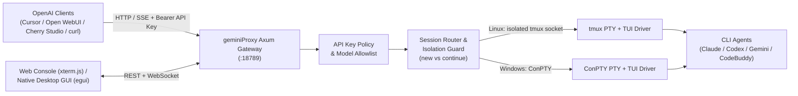

<div align="center">

# geminiProxy

**Turn any CLI AI coding agent running in a real terminal into a standard OpenAI-compatible LLM API.**

*Claude Code · Codex CLI · Gemini CLI · CodeBuddy · Any Interactive TUI/Shell Agent*

[](https://www.rust-lang.org/)
[](#quick-start)
[](#openai-api-endpoints)
[](#two-ways-to-use)
[](LICENSE)

[English](README.md) | [简体中文](README_CN.md)

</div>

---

## Why geminiProxy?

CLI agents (**Claude Code**, **OpenAI Codex CLI**, **Gemini CLI**, **CodeBuddy**, etc.) are often locked inside interactive terminal sessions. **geminiProxy** wraps real terminal PTYs (`tmux` on Linux, `ConPTY` on Windows) behind a high-performance Rust HTTP/WebSocket gateway so **any OpenAI client** — Cursor, Open WebUI, Continue, Cherry Studio, OneAPI, `sub2api`, or `curl` — can call them directly.

Unlike naive `subprocess` wrappers that spawn stateless one-shot processes on every request, **geminiProxy keeps live, stateful agent sessions warm** while enforcing strict multi-tenant conversation isolation.

### Key Highlights

| Feature | What It Does |
| :--- | :--- |
| **Linux & Windows Cross-Platform** | Uses isolated `tmux` sockets (`tmux -L gproxy_<id>`) on Linux and native `ConPTY` (`powershell.exe` / `cmd.exe`) on Windows. |
| **Dual Mode: Web UI + Native GUI** | Run headless with an embedded `xterm.js` **Web Console** (`gemini-proxy`), or launch the native **`eframe`/`egui` Desktop GUI** (`gemini-proxy-gui`) with built-in server & playground. |
| **Strict Conversation Isolation** | Automatically distinguishes **new conversations** vs **continuations** using `previous_response_id`, conversation message-prefix hashes, and owner API key binding — preventing cross-user or cross-thread memory leakage. |
| **API Key ↔ Model Access Control** | Per-key model allowlists (`allowed_models`) with constant-time bearer/key verification. |
| **On-Demand Auto-Launch & LRU Eviction** | Requests targeting an unstarted model automatically spawn and settle the right CLI agent session, and evict idle sessions when `max_sessions` or `idle_ttl_secs` is reached. |
| **Live Model Sensing & `/model` Auto-Switch** | Reads the active model straight from the terminal TUI / process cmdline and automatically sends `/model <target>` if the requested upstream model differs. |
| **Quota Exhaustion Auto-Rotation** | Detects credit/quota exhaustion messages in agent output and optionally rotates accounts via a configurable local rotator endpoint (`ACCOUNT_ROTATOR_ADDR` + `ACCOUNT_ROTATOR_TOKEN_FILE`). |
| **Full OpenAI Compatibility** | Supports `/v1/models`, `/v1/chat/completions`, `/v1/responses`, non-`/v1` aliases, and real-time SSE streaming (`"stream": true`). |

---

## Architecture



---

## Two Ways to Use

| Binary | Mode | Best For |
| :--- | :--- | :--- |
| `gemini-proxy` (`gemini-proxy.exe`) | **Headless + Web UI** | Servers, Linux `systemd` services, Docker/LAN sharing (`http://<host>:18789/`) |
| `gemini-proxy-gui` (`gemini-proxy-gui.exe`) | **Native Desktop GUI + Web UI** | Local desktop users on Windows or Linux — embeds the API server and lets you watch terminals, test completions, copy API keys, or open the Web UI in one click |

---

## Quick Start

### Option A: Download Pre-built Binaries

Grab the latest binaries from [**GitHub Releases**](https://github.com/beyondcy1013/geminiProxy/releases):

- **Linux**: `gemini-proxy-linux-x86_64` (Web/Server) · `gemini-proxy-gui-linux-x86_64` (Desktop GUI)
- **Windows**: `gemini-proxy-windows-x86_64.exe` (Web/Server) · `gemini-proxy-gui-windows-x86_64.exe` (Desktop GUI)

```bash
# Linux Web/Server mode (binds LAN by default if --host 0.0.0.0)
chmod +x gemini-proxy-linux-x86_64
./gemini-proxy-linux-x86_64 --host 0.0.0.0 --port 18789 --open

# Linux Desktop GUI mode
chmod +x gemini-proxy-gui-linux-x86_64
./gemini-proxy-gui-linux-x86_64
```

On Windows, double-click `gemini-proxy-gui-windows-x86_64.exe` for the desktop app, or run `gemini-proxy-windows-x86_64.exe --open` in PowerShell.

> **Linux prerequisite**: `tmux` installed (`sudo apt install tmux` / `sudo dnf install tmux`) for persistent tmux-backed terminal sessions.

---

### Option B: Build from Source

Requires Rust toolchain (edition 2024):

```bash
git clone https://github.com/beyondcy1013/geminiProxy.git
cd geminiProxy

# Build headless/Web binary only
cargo build --release

# Build both Web binary and Native Desktop GUI binary
cargo build --release --features gui
```

---

### Option C: Install as a Linux `systemd` Service

Use the provided template [`deploy/gemini-proxy.service.example`](deploy/gemini-proxy.service.example):

```bash
sudo mkdir -p /opt/gemini-proxy /var/lib/gemini-proxy
sudo cp target/release/gemini-proxy /opt/gemini-proxy/gemini-proxy
sudo cp deploy/gemini-proxy.service.example /etc/systemd/system/gemini-proxy.service
sudo systemctl daemon-reload
sudo systemctl enable --now gemini-proxy
```

---

## OpenAI API Endpoints

| Method | Path | Description |
| :--- | :--- | :--- |
| `GET` | `/v1/models` (or `/models`) | List models permitted for the caller's API key |
| `POST` | `/v1/chat/completions` (or `/chat/completions`) | OpenAI Chat Completions (`stream: false` and `stream: true` SSE) |
| `POST` | `/v1/responses` (or `/responses`) | OpenAI Responses API with `previous_response_id` continuation |
| `GET` | `/health` | Health check |

When starting with an empty config, `geminiProxy` generates a local API key printed to stdout/logs and stored in `<data-dir>/config.json` (and visible in the Web UI / Desktop GUI).

### Example: Chat Completions

```bash
curl http://127.0.0.1:18789/v1/chat/completions \
  -H "Authorization: Bearer YOUR_API_KEY" \
  -H "Content-Type: application/json" \
  -d '{
    "model": "codebuddy-hy4flash-free",
    "messages": [
      {"role": "user", "content": "Explain Rust ownership in two sentences."}
    ]
  }'
```

### Example: Streaming SSE

```bash
curl -N http://127.0.0.1:18789/v1/chat/completions \
  -H "Authorization: Bearer YOUR_API_KEY" \
  -H "Content-Type: application/json" \
  -d '{
    "model": "codebuddy-hy4flash-free",
    "stream": true,
    "messages": [
      {"role": "user", "content": "Write a quicksort in Rust."}
    ]
  }'
```

### Example: Multi-Turn Isolation via Responses API

Pass `previous_response_id` to continue an existing terminal conversation cleanly; omit it (or send a different message prefix) to isolate the request into a fresh session:

```bash
# Turn 1 -> response header returns x-gemini-proxy-turn-mode: new
curl -s http://127.0.0.1:18789/v1/responses \
  -H "Authorization: Bearer YOUR_API_KEY" \
  -H "Content-Type: application/json" \
  -d '{"model":"gemini-proxy-agent","input":"Remember code ALPHA-42"}'

# Turn 2 -> pass previous_response_id -> x-gemini-proxy-turn-mode: continue
curl -s http://127.0.0.1:18789/v1/responses \
  -H "Authorization: Bearer YOUR_API_KEY" \
  -H "Content-Type: application/json" \
  -d '{"model":"gemini-proxy-agent","previous_response_id":"resp_...","input":"What code did I ask you to remember?"}'
```

### Response Observability Headers

Every `/v1/chat/completions` and `/v1/responses` call returns diagnostic headers:

- `x-gemini-proxy-session-id` — terminal session ID that served the turn
- `x-gemini-proxy-turn-mode` — `new` or `continue`
- `x-gemini-proxy-detected-model` — live model sensed from the agent TUI/process
- `x-gemini-proxy-model-switched` — target model if `/model` auto-switch occurred
- `x-gemini-proxy-account-rotated` — rotated account label if quota exhaustion triggered rotation

---

## Configuration (`<data-dir>/config.json`)

You can manage **API Keys** and **Model Specs** directly in the Web UI / Desktop GUI or edit `<data-dir>/config.json`:

- `api_keys`: `{ name, key, allowed_models }` — leave `allowed_models` empty to allow all configured models.
- `models`: `{ id, agent_kind, upstream_model, launch_command, cwd, use_markers, max_sessions, idle_ttl_secs, startup_settle_ms }`.
  - `agent_kind`: `auto`, `claude`, `codex`, `agy`, `codebuddy`, `generic`.

### CLI Options

| Flag | Default | Description |
| :--- | :--- | :--- |
| `--host` | `0.0.0.0` | Listen address |
| `--port` | `18789` | HTTP & WebSocket port |
| `--data-dir` | `./data` | Directory for `config.json` and `sessions.json` |
| `--idle-quiesce-ms` | `1200` | Wait time after terminal output stops before finalizing response |
| `--turn-timeout-secs` | `180` | Max seconds to wait per API turn |
| `--open` | `false` | Open the Web UI in your default browser on startup |

---

## Security & Privacy Notes

- Never expose `<data-dir>/config.json` or API keys publicly.
- By default `--host 0.0.0.0` listens on your LAN so devices on the same network can connect. If you only want local loopback access, pass `--host 127.0.0.1`.
- Sessions are bound to the owning API key (`owner_key_id`); one API key cannot hijack or resume another key's active conversation.

---

## License

MIT — see [LICENSE](LICENSE).

If **geminiProxy** helps your workflow, please consider giving it a **Star**!
