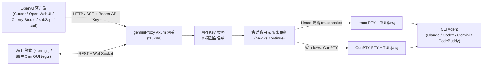

<div align="center">

# geminiProxy

**把运行在真实终端里的任意 CLI AI Agent 代理成标准 OpenAI 兼容 LLM API。**

*支持 Claude Code · Codex CLI · Gemini CLI · CodeBuddy 等终端交互式智能体*

[](https://www.rust-lang.org/)
[](#快速开始)
[](#openai-兼容接口)
[](#两种使用方式)
[](LICENSE)

[English](README.md) | [简体中文](README_CN.md)

</div>

---

## 为什么选择 geminiProxy？

很多强大的 AI 编程智能体（**Claude Code**、**Codex CLI**、**Gemini CLI**、**CodeBuddy** 等）以交互式终端 TUI 的形式运行，无法直接接入 Cursor、Open WebUI、Cherry Studio、OneAPI 或 `sub2api`。

**geminiProxy** 用 Rust 在真实终端 PTY（Linux 下基于隔离 `tmux` socket，Windows 下基于 `ConPTY`）之上构建了一层轻量、可靠的 OpenAI API 网关，既能保留多轮会话状态，又严格隔离不同会话，避免上下文串台。

### 核心特性

| 特性 | 说明 |
| :--- | :--- |
| **Linux & Windows 跨平台** | Linux 使用隔离 `tmux -L gproxy_<id>` 会话（进程重启不丢终端）；Windows 原生支持 `ConPTY`（PowerShell / cmd）。 |
| **Web 页面 + 原生桌面 GUI 双模式** | 既可运行服务端 + `xterm.js` **Web 控制台**（支持局域网访问），也可直接运行带内置服务的 **`eframe`/`egui` 原生桌面程序**。 |
| **严格的新旧对话隔离** | 通过 `previous_response_id`、对话历史前缀哈希与 `owner_key_id` 精确区分**新对话 (`new`)** 与**续聊 (`continue`)**，杜绝跨用户/跨线程上下文泄漏。 |
| **API Key ↔ 模型白名单鉴权** | 每个 API Key 可独立配置 `allowed_models` 权限边界，采用常量时间校验。 |
| **按需自动拉起与 LRU 回收** | 收到已授权模型请求但暂无空闲终端时，自动创建终端并拉起对应 Agent；超出 `max_sessions` 或 `idle_ttl_secs` 自动回收。 |
| **模型感知与自动 `/model` 切换** | 实时感知终端内 Agent 当前使用的底层大模型；与请求不一致时自动发送 `/model <target>` 切换后再执行。 |
| **额度耗尽感知与自动换号** | 识别终端输出的额度/积分不足提示，并支持通过可配置的本地轮换接口（`ACCOUNT_ROTATOR_ADDR` + `ACCOUNT_ROTATOR_TOKEN_FILE`）自动切换账号并重试。 |
| **完整 OpenAI 接口兼容** | 支持 `/v1/models`、`/v1/chat/completions`、`/v1/responses`、非 `/v1` 别名以及 SSE 流式输出（`stream: true`）。 |

---

## 架构总览



---

## 两种使用方式

| 可执行文件 | 模式 | 适用场景 |
| :--- | :--- | :--- |
| `gemini-proxy` / `gemini-proxy.exe` | **服务端 + Web 页面** | Linux 服务器、`systemd` 后台常驻、局域网共享（浏览器打开 `http://<IP>:18789/`） |
| `gemini-proxy-gui` / `gemini-proxy-gui.exe` | **原生桌面 GUI + 内置 Web 服务** | Windows / Linux 桌面用户双击即用：内置服务器、实时会话列表、API 调试面板、一键复制 API Key、一键打开浏览器 Web 终端 |

---

## 快速开始

### 方式一：直接下载预编译包

前往 [**GitHub Releases**](https://github.com/beyondcy1013/geminiProxy/releases) 下载对应平台二进制文件：

- **Linux**: `gemini-proxy-linux-x86_64`（Web/服务端） · `gemini-proxy-gui-linux-x86_64`（原生桌面 GUI）
- **Windows**: `gemini-proxy-windows-x86_64.exe`（Web/服务端） · `gemini-proxy-gui-windows-x86_64.exe`（原生桌面 GUI）

```bash
# Linux 服务端/Web 模式
chmod +x gemini-proxy-linux-x86_64
./gemini-proxy-linux-x86_64 --host 0.0.0.0 --port 18789 --open

# Linux 桌面 GUI 模式
chmod +x gemini-proxy-gui-linux-x86_64
./gemini-proxy-gui-linux-x86_64
```

Windows 下直接双击 `gemini-proxy-gui-windows-x86_64.exe` 即可使用图形界面；或运行 `gemini-proxy-windows-x86_64.exe --open` 打开浏览器 Web 控制台。

> **Linux 环境依赖**：请确保已安装 `tmux`（`apt install tmux` 或 `dnf install tmux`）。

---

### 方式二：源码编译

```bash
git clone https://github.com/beyondcy1013/geminiProxy.git
cd geminiProxy

# 仅编译服务端 + Web UI
cargo build --release

# 同时编译 Web 服务端与原生桌面 GUI
cargo build --release --features gui
```

---

### 方式三：配置 Linux `systemd` 系统服务

仓库提供了通用模板 [`deploy/gemini-proxy.service.example`](deploy/gemini-proxy.service.example)：

```bash
sudo mkdir -p /opt/gemini-proxy /var/lib/gemini-proxy
sudo cp target/release/gemini-proxy /opt/gemini-proxy/gemini-proxy
sudo cp deploy/gemini-proxy.service.example /etc/systemd/system/gemini-proxy.service
sudo systemctl daemon-reload
sudo systemctl enable --now gemini-proxy
```

---

## OpenAI 兼容接口

| 方法 | 路径 | 用途 |
| :--- | :--- | :--- |
| `GET` | `/v1/models`（或 `/models`） | 列出当前 API Key 有权访问的模型 |
| `POST` | `/v1/chat/completions`（或 `/chat/completions`） | 标准 Chat Completions（支持 `stream: true` SSE） |
| `POST` | `/v1/responses`（或 `/responses`） | Responses API，支持 `previous_response_id` 续聊 |
| `GET` | `/health` | 健康检查 |

首次启动若无配置文件，会自动生成一个默认 API Key（打印到日志并保存在 `<data-dir>/config.json`，也可直接在 Web UI / 桌面 GUI 中查看与复制）。

### 调用示例

```bash
curl http://127.0.0.1:18789/v1/chat/completions \
  -H "Authorization: Bearer YOUR_API_KEY" \
  -H "Content-Type: application/json" \
  -d '{
    "model": "codebuddy-hy4flash-free",
    "messages": [
      {"role": "user", "content": "用两句话介绍 Rust 所有权机制"}
    ]
  }'
```

### 响应头观测字段

- `x-gemini-proxy-session-id`：本次实际执行的终端会话 ID
- `x-gemini-proxy-turn-mode`：`new`（新对话）或 `continue`（延续老对话）
- `x-gemini-proxy-detected-model`：终端内实际感知到的 Agent 模型
- `x-gemini-proxy-model-switched`：若触发了 `/model` 自动切换，显示目标模型
- `x-gemini-proxy-account-rotated`：若触发了额度不足自动换号，显示新账号标识

---

## 常见启动参数

| 参数 | 默认值 | 说明 |
| :--- | :--- | :--- |
| `--host` | `0.0.0.0` | 监听地址（仅本机访问可改为 `127.0.0.1`） |
| `--port` | `18789` | HTTP / WebSocket 监听端口 |
| `--data-dir` | `./data` | `config.json` 与 `sessions.json` 存储目录 |
| `--idle-quiesce-ms` | `1200` | 终端停止输出后等待收敛的静默毫秒数 |
| `--turn-timeout-secs` | `180` | 单轮对话最大等待超时（秒） |
| `--open` | `false` | 启动后自动用默认浏览器打开 Web 控制台 |

---

## 开源协议

本项目基于 [MIT License](LICENSE) 开源。如果对你有帮助，欢迎点一颗 **Star** 支持！
